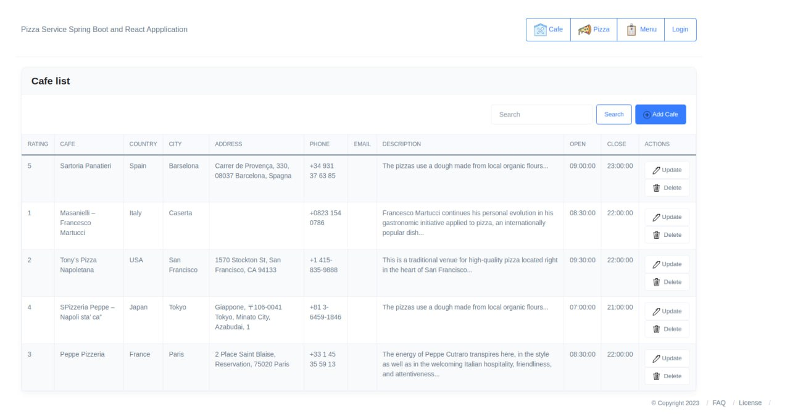

# Pizza Service frontend (Tel-Ran, 2023)

[English](README.md) | [Русский](README.ru.md)

The React frontend of Pizza Service, my diploma project at Tel-Ran. I built this frontend myself. It includes cafe listings, cafe creation and editing, and a pizza catalogue.

The [Java backend](https://github.com/ivan-zamula/pizza-service-backend-2023-tel-ran) provides the REST API.

## Preview



The cafe list in the React frontend I built for my Tel-Ran diploma project.

## Stack and structure

React, React Router, Axios, Bootstrap, Reactstrap and Material UI. The app is built with `react-scripts` 5.

| Path | Content |
| --- | --- |
| [frontend/src/App.js](frontend/src/App.js) | Application routes |
| [frontend/src/components/cafe](frontend/src/components/cafe) | Cafe pages |
| [frontend/src/components/pizza](frontend/src/components/pizza) | Pizza list |
| [frontend/src/services](frontend/src/services) | Axios clients for the backend |
| [frontend/package.json](frontend/package.json) | Dependencies and npm scripts |

## Run locally

Install Node.js and npm. Start the paired backend on `http://localhost:8080` before using the interface.

```bash
git clone https://github.com/ivan-zamula/pizza-service-frontend-2023-tel-ran.git
cd pizza-service-frontend-2023-tel-ran
```

```bash
cd frontend
npm ci
npm start
```

Open [http://localhost:3000](http://localhost:3000). The API addresses are set in [CafeService.js](frontend/src/services/CafeService.js) and [PizzaService.js](frontend/src/services/PizzaService.js).

From `frontend/`, `npm run build` creates a bundle in `build/`, and `npm test` starts the test runner. The `homepage` setting in `package.json` sets the asset base path for a hosted build.
